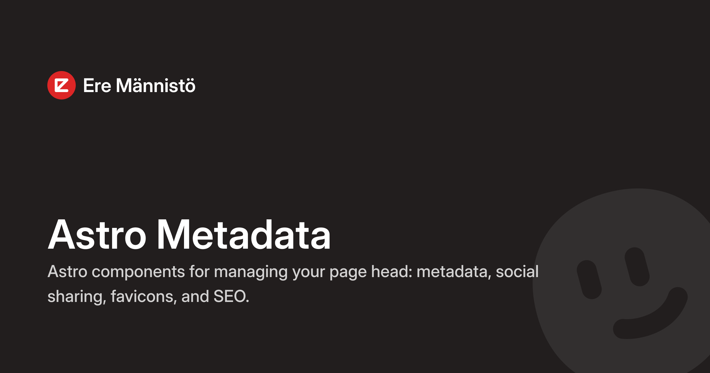
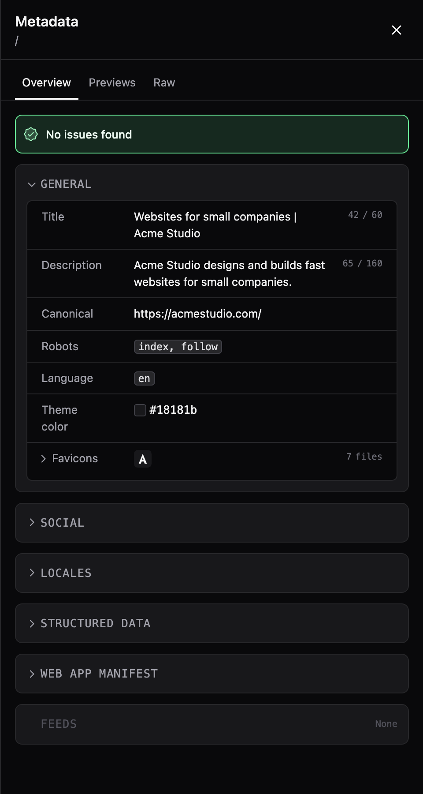
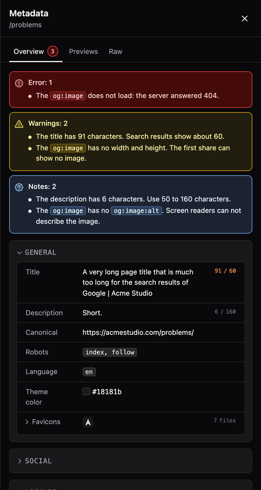
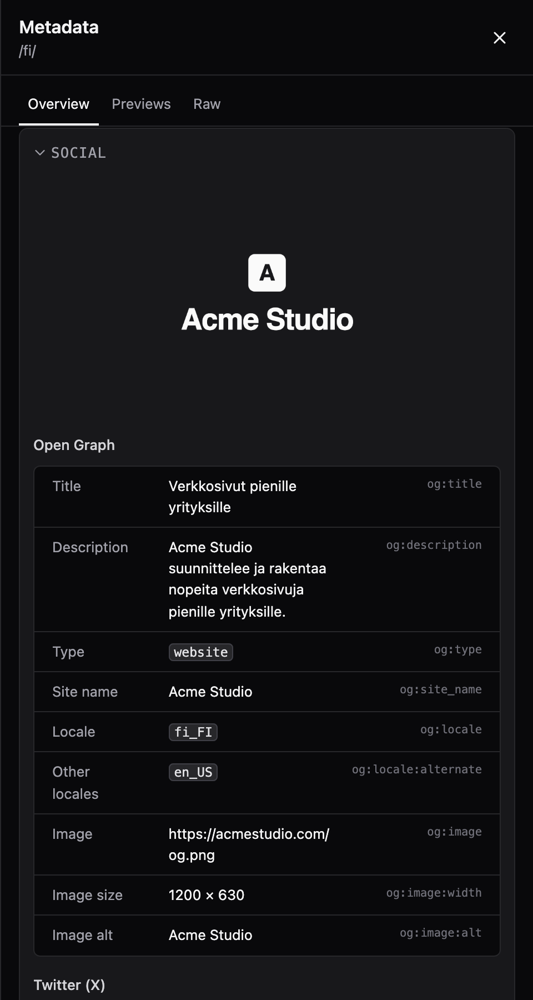
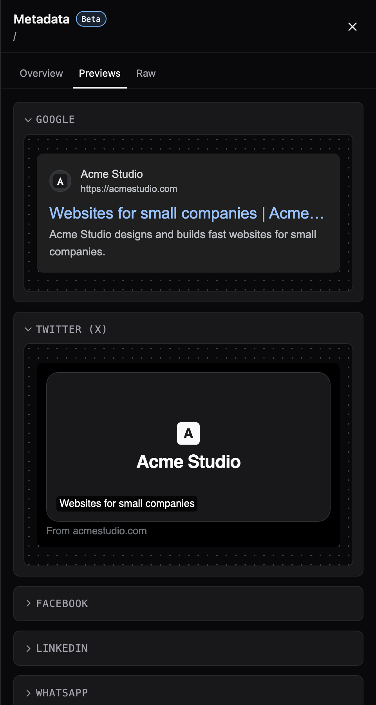
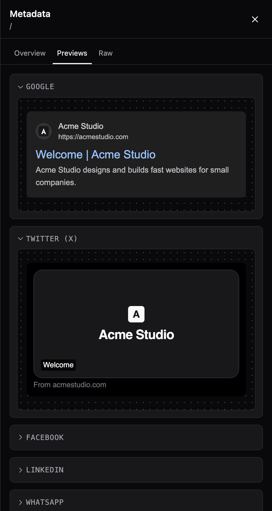

# Astro Metadata




The page metadata for Astro: the title, the description, the canonical URL, social cards, favicons, the web app manifest and structured data. Set the site values one time, and give each page only its own values. In dev, an app in the Astro dev toolbar checks each page.

- [Install](#install)
- [Configuration](#configuration)
- [Metadata component](#metadata-component)
- [Favicons](#favicons)
- [Web app manifest](#web-app-manifest)
- [Structured data](#structured-data)
- [Dev toolbar app](#dev-toolbar-app)
- [Checks](#checks)
- [API](#api)
- [Good to know](#good-to-know)
- [Migrate from v1](#migrate-from-v1)
- [Contributing](#contributing)
- [License](#license)

## Install

```bash
npm install @mannisto/astro-metadata
```

The integration requires Astro 6.4.6 or later, or Astro 7.

## Configuration

```typescript
// astro.config.ts
import metadata from "@mannisto/astro-metadata"
import { defineConfig } from "astro/config"

export default defineConfig({
  site: "https://example.com",
  integrations: [
    metadata({
      siteName: "Acme Studio",
      titleTemplate: "%s | Acme Studio",
      description: "Tools for small teams.",
      image: { url: "/og.jpg", alt: "Acme Studio", width: 1200, height: 630 },
      twitter: { site: "@acmestudio" },
      themeColor: "#111111",
      feeds: [{ href: "/rss.xml", title: "News" }],
      favicon: { source: "./src/assets/logo.svg" },
      manifest: { name: "Acme Studio" },
    }),
  ],
})
```

Set `site` in the Astro config. The canonical URL and the social images must be absolute URLs, and the package uses `site` to make them.

| Option | Default | Description |
|---|---|---|
| `siteName` | — | The name of the site: the title of a page without a title, and `og:site_name`. |
| `titleTemplate` | — | The title template, for example `"%s \| My Site"`. `%s` is the page title. |
| `description` | — | The description of a page without a description. |
| `image` | — | The social image of a page without an image: `url`, `alt`, `width` and `height`. |
| `twitter` | — | `site`: the Twitter (X) handle of the site. `card`: `"summary"` or `"summary_large_image"` (default) for pages with an image. |
| `themeColor` | — | The color of the browser interface. Give one color, or `{ light, dark }`. |
| `feeds` | — | The RSS, Atom or JSON feeds: `href`, `title` and `type` (`"rss"` by default). |
| `robots` | — | `index: false` or `follow: false` for all pages, for example on a staging site. `extra`: other directives, for example `"max-image-preview:large"`. |
| `favicon` | — | Generates the favicons from one image. See [Favicons](#favicons). |
| `manifest` | — | Generates the web app manifest, or links your own. See [Web app manifest](#web-app-manifest). |
| `schema` | — | The structured data of the site: `publisher` is the organization or the person behind the site. `false` turns it off. See [Structured data](#structured-data). |
| `debug` | `true` | The dev toolbar app (`client`) and the build log (`build`). See [Checks](#checks). |
| `rules` | — | `ignore`: the ids of the check rules to turn off. `custom`: your own rules. See [Checks](#checks). |
| `pages` | — | `ignore`: the pages without checks, as path patterns, for example `["/404", "/drafts/**"]`. See [Checks](#checks). |

### Translations

Each text can be one string, or an object with one string for each locale:

```typescript
metadata({
  siteName: { en: "Acme Studio", fi: "Acme Studio Suomi" },
  titleTemplate: { en: "%s | Acme Studio", fi: "%s | Acme Studio Suomi" },
})
```

`<Metadata>` uses the text of the locale of the page, or of its `locale` prop. A locale without a text uses the first text.

### Locales

`<Metadata>` reads the locales from your i18n setup. You do not need extra code:

- **[`@mannisto/astro-i18n`](https://github.com/eremannisto/astro-i18n):** the locale, the public URL of the page (`/about` and not `/en/about`) and the hreflang links.
- **The `i18n` option of Astro:** the locale and the hreflang links.

The hreflang links contain the page in each locale, and `x-default` for the default locale. To give your own links, use the `hreflang` prop. `hreflang={[]}` turns the links off, for example on a 404 page.

The same locales give `og:locale` and `og:locale:alternate`, in the `language_COUNTRY` format of Open Graph: `fi` becomes `fi_FI`, and `en-GB` becomes `en_GB`.

## Metadata component

Put `<Metadata>` into the `<head>` of your layout, and give it the values of the page:

```astro
---
// src/layouts/Layout.astro
import { Metadata, type MetadataProps } from "@mannisto/astro-metadata/components"

type Props = MetadataProps
---

<html lang="en">
  <head>
    <Metadata {...Astro.props} />
  </head>
  <body>
    <slot />
  </body>
</html>
```

```astro
---
// src/pages/about.astro
import Layout from "../layouts/Layout.astro"
---

<Layout title="About" description="The story of Acme Studio.">
  <h1>About</h1>
</Layout>
```

The page values override the site values. For example, `title="About"` gives:

```html
<meta charset="UTF-8">
<meta name="viewport" content="width=device-width, initial-scale=1">
<title>About | Acme Studio</title>
<meta name="description" content="The story of Acme Studio.">
<link rel="canonical" href="https://example.com/about/">
<meta property="og:title" content="About">
<meta property="og:description" content="The story of Acme Studio.">
<meta property="og:url" content="https://example.com/about/">
<meta property="og:type" content="website">
<meta property="og:site_name" content="Acme Studio">
<meta property="og:image" content="https://example.com/og.jpg">
<meta name="twitter:card" content="summary_large_image">
<meta name="twitter:site" content="@acmestudio">
...
```

| Prop | Default | Description |
|---|---|---|
| `title` | `siteName` | The page title. The title template adds the site name. |
| `description` | `description` | The page description. |
| `image` | `image` | The social image: `url`, `alt`, `width` and `height`. |
| `type` | `"website"` | The Open Graph type, for example `"article"`. |
| `author` | — | The author of an article: a name, or `{ name, url, twitter }`. `twitter` gives `twitter:creator`. |
| `published` | — | The publication date of an article. |
| `modified` | — | The date of the last change of an article. |
| `canonical` | The current page | The canonical path or URL. With `@mannisto/astro-i18n`, the default is the public URL of the page. |
| `index` | `true` | `false` keeps the page out of search results. |
| `follow` | `true` | `false` tells search engines not to follow the links. |
| `hreflang` | From the i18n setup | The hreflang links: the page in each locale, and `x-default`: `{ hreflang, href }[]`. See [Locales](#locales). |
| `breadcrumbs` | — | The path from the home page to the page: `{ name, url }[]`. See [Structured data](#structured-data). |
| `schema` | — | Structured data items of your own, for example a `Product`. See [Structured data](#structured-data). |
| `locale` | The locale of the page | The locale of the translated site values. See [Locales](#locales). |

A tag is rendered only when it has a value. For example, the robots tag is necessary only with `index` or `follow` set to `false`.

### Single components

`<Metadata>` renders all tags. To render only some of them, use the single components. They take the same props as `<Metadata>`, and they use the same site values:

```astro
---
import { Canonical, OpenGraph, Title } from "@mannisto/astro-metadata/components"
---

<Title title="About" />
<Canonical />
<OpenGraph title="About" />
```

| Component | Tags |
|---|---|
| `<Title>` | `title` |
| `<Description>` | `description` |
| `<Canonical>` | The canonical link |
| `<Robots>` | `robots` |
| `<ThemeColor>` | `theme-color` |
| `<OpenGraph>` | `og:*` and `article:*` |
| `<Twitter>` | `twitter:*` |
| `<Favicon>` | The favicon links |
| `<Manifest>` | The manifest link |
| `<Feeds>` | The feed links |
| `<LanguageAlternates>` | The hreflang links |
| `<Schema>` | The structured data |

## Favicons

Give one square source image. An SVG gives the best result. Use a PNG, WebP or JPEG of at least 512 × 512 px, or the large icons become blurred.

```typescript
metadata({
  favicon: {
    source: "./src/assets/logo.svg",
    background: "#ffffff",
  },
})
```

The integration generates these files, and `<Metadata>` renders their tags in the recommended order:

| File | Use |
|---|---|
| `/favicon.ico` | 16 and 32 px, for old browsers and tools |
| `/favicon.svg` | Modern browsers. Only for an SVG source. |
| `/favicon-16.png`, `/favicon-32.png` | Browser tabs |
| `/apple-touch-icon.png` | 180 px, for the iOS home screen |
| `/favicon-192.png`, `/favicon-512.png` | The web app manifest |

iOS shows transparent pixels as black, so the Apple icon shows the logo on the `background` color (white by default).

To generate other files, give a `files` list. It replaces the default files:

```typescript
favicon: {
  source: "./src/assets/logo.svg",
  files: [
    { path: "/favicon.ico", sizes: [16, 32, 48] },
    { path: "/favicon.svg" },
    { path: "/apple-touch-icon.png", size: 180 },
    { path: "/favicon-96.png", size: 96 },
    { path: "/favicon-512.png", size: 512 },
  ],
}
```

The extension sets the format: `.ico`, `.png` or `.svg`. The name and the size set the use:

- `.ico` and `.svg` files, and `.png` files smaller than 192 px, get an icon link tag.
- `apple-touch-icon.png` gets the Apple link tag.
- `.png` files of 192 px or larger go into the web app manifest.

Keep the names `favicon.ico` and `apple-touch-icon.png`. Browsers and iOS ask for these URLs directly.

## Web app manifest

Give the manifest as an object, and the integration serves it at `/manifest.webmanifest` with the generated icons:

```typescript
metadata({
  manifest: {
    name: "Acme Studio",
    shortName: "Acme",
    backgroundColor: "#ffffff",
  },
})
```

| Value | Default | Description |
|---|---|---|
| `name` | — | The name of the app. |
| `shortName` | — | The name on the home screen. |
| `description` | — | The description of the app. |
| `startUrl` | `"/"` | The page that the installed app opens. |
| `display` | `"standalone"` | `"standalone"`, `"fullscreen"`, `"minimal-ui"` or `"browser"`. |
| `themeColor` | `themeColor` | The color of the app interface. |
| `backgroundColor` | — | The color of the start screen. |
| `extra` | — | Other manifest fields, copied into the file unchanged. |

With translated texts, each locale gets its own manifest: the first locale at `/manifest.webmanifest`, the others at `/fi/manifest.webmanifest` and so on.

To use your own manifest, give its path. The integration then only renders the link tag:

```typescript
metadata({
  manifest: "/site.webmanifest",
})
```

Your own manifest endpoint can use the generated icons with `Site.icons()`:

```typescript
// src/pages/site.webmanifest.ts
import { Site } from "@mannisto/astro-metadata/runtime"

export const GET = () => {
  return Response.json({ name: Site.name(), icons: Site.icons() })
}
```

## Structured data

`<Metadata>` renders the structured data (JSON-LD) of each page by itself. You only give the values of the page.

**The site.** Each page gets the `WebSite` and its publisher: by default, an organization with the site name. Give the logo and the profiles in the config:

```typescript
metadata({
  siteName: "Acme Studio",
  schema: {
    publisher: {
      logo: "/logo.png",
      sameAs: ["https://github.com/acme-studio"],
    },
  },
})
```

For a personal site, use `publisher: { type: "Person" }`. Set `schema: false` to turn off the site data.

**An article.** Set `type="article"`. The article uses the title, the description and the image of the page:

```astro
<Metadata
  title="Hello"
  type="article"
  published={post.date}
  author={{ name: "Acme Writer", url: "/about", twitter: "@acmewriter" }}
/>
```

**Breadcrumbs.** Give the path from the home page to the page:

```astro
<Metadata
  breadcrumbs={[
    { name: "Home", url: "/" },
    { name: "Blog", url: "/blog" },
  ]}
/>
```

**Your own items.** Give other types, for example a `Product` or an `Event`, in `schema`. The types come from [`schema-dts`](https://github.com/google/schema-dts), so your editor completes the schema.org fields:

```astro
<Metadata schema={{ "@type": "Event", name: "Opening night", startDate: "2026-11-01" }} />
```

All items go into one graph. The items link to each other with `@id`, and all URLs are absolute.

## Dev toolbar app

Run `astro dev`, and open the Metadata app in the dev toolbar, or press `Alt+M` (`Option+M` on a Mac). The app checks the current page, and shows its tags and its link previews. Click a problem to open the row of its tag.

<table>
  <tr>
    <td></td>
    <td></td>
    <td></td>
  </tr>
  <tr>
    <td></td>
    <td></td>
    <td></td>
  </tr>
</table>

## Checks

The dev toolbar app checks the current page. The build checks all prerendered pages, also against each other (the same title on two pages, hreflang links that do not link back), and logs the errors and the warnings:

```
[WARN] [@mannisto/astro-metadata] /about/index.html
  - The page has no description.
```

| Level | Meaning | Examples |
| --- | --- | --- |
| Error | The metadata is broken. | No title, placeholder text such as `undefined`, invalid JSON-LD, an `og:image` that does not load |
| Warning | Fix it for better results. | A long title, the same title on two pages, an `og:image` over 600 KB |
| Info | Good to know. | `noindex`, a short description, no `og:image:alt` |

To turn off the checks, use `debug`:

```typescript
metadata({
  debug: { client: false }, // No dev toolbar app
  // debug: { build: false }, // No build log
  // debug: false, // Neither
})
```

### Turn off rules

Give the ids of the rules in `rules.ignore`. All rules and their ids are in [`src/lib/rules.js`](./src/lib/rules.js).

```typescript
metadata({
  rules: {
    ignore: ["description-short", "og-image-alt-missing"],
  },
})
```

### Custom rules

Add your own rules in `rules.custom`. A rule has an `id`, a `level` (`"error"`, `"warning"` or `"info"`), a `message`, and a `check` function that returns `true` when the page has the problem:

```typescript
metadata({
  rules: {
    custom: [
      {
        id: "title-brand",
        level: "warning",
        message: "The title must contain the brand name.",
        check(head) {
          return !head.titles[0]?.includes("Acme Studio")
        },
      },
    ],
  },
})
```

The `head` has the metadata of the page:

| Value | Description |
|---|---|
| `titles` | The texts of all title tags. |
| `meta` | The first `content` of each meta tag, by its `name` or `property`, for example `head.meta["og:image"]`. |
| `metaCount` | The number of meta tags with each name. |
| `links` | The attributes of all link tags, for example `{ rel: "canonical", href: "…" }`. |
| `schemas` | The texts of the JSON-LD scripts. |
| `lang`, `charset` | The `lang` attribute of the html tag, and the charset. |

The rule can also have:
- `message` as a function, `(head) => string`, for a message with values of the page.
- `field`, the tag of the problem, for example `"og:title"`. A click on the problem in the dev toolbar app opens its row.
- `indexed: true`, to skip the rule on a noindex page.

Text between backticks in a message shows as code in the dev toolbar app. The `MetadataRule` type gives your editor completion.

### Ignore pages

Give the paths of the pages without checks in `pages.ignore`, without the base. `*` matches one part of the path, and `**` matches any number of parts:

```typescript
metadata({
  pages: {
    ignore: ["/404", "/drafts/**"],
  },
})
```

The dev toolbar app still shows the values of these pages, but no problems.

## API

`Site` returns the values that you set in the integration, for example for a footer, a feed or your own manifest:

```typescript
import { Site } from "@mannisto/astro-metadata/runtime"

Site.description({ locale: "fi" })
```

| Method | Returns |
|---|---|
| `Site.name()` | `siteName` |
| `Site.template()` | `titleTemplate` |
| `Site.description()` | `description` |
| `Site.image()` | `image`, with an absolute URL |
| `Site.twitter()` | `twitter`, with the default card |
| `Site.themeColor()` | `themeColor` |
| `Site.icons()` | The generated favicons, for the `icons` of a web app manifest |

A translated text returns the text of `locale`, or the first text without `locale`. An option that is not set returns `undefined`.

Import the types from `@mannisto/astro-metadata/runtime`, for example `import type { MetadataImage } from "@mannisto/astro-metadata/runtime"`.

## Good to know

- **CMS data.** Give CMS values to `<Metadata>` as props. The site values of the integration are fixed at startup, and a change restarts the dev server.
- **Trailing slash.** The canonical URL and the `hreflang` links follow the `trailingSlash` setting of Astro. With `"ignore"`, `build.format` decides.
- **`sharp`.** The favicons use the `sharp` package that Astro installs. If you install Astro without its optional dependencies, install `sharp` yourself.
- **Files in `public/`.** A file in `public/` with the same path as a generated favicon replaces the generated file. The integration shows a warning.

## Migrate from v1

Version 2 is a new API. The main changes:

### Move the site values into the integration

```diff
- <Head title="About" titleTemplate="%s | My Site" description="..." />
+ metadata({ titleTemplate: "%s | My Site", description: "..." })
```

### Use `<Metadata>` inside your own `<head>`

`<Head>` rendered the `<head>` element. `<Metadata>` renders only the tags.

```diff
- import { Head } from "@mannisto/astro-metadata"
+ import { Metadata } from "@mannisto/astro-metadata/components"

- <Head title="About" />
+ <head>
+   <Metadata title="About" />
+ </head>
```

### Use the new props of the single components

The single components take the props of `<Metadata>`, and `<Metadata>` renders all of them. `Keywords` is removed, because search engines do not use the tag.

```diff
- <LanguageAlternates alternates={links} />
+ <LanguageAlternates hreflang={links} />
```

### Replace the `Metadata` store

`Metadata.set()` and `Metadata.resolve()` are removed. Give the values as props to your layout.

### Replace the robots object and the `false` props

```diff
- <Head robots={{ index: false }} twitter={false} />
+ <Metadata index={false} />
```

### Generate the favicons

```diff
- <Head favicon={{ icons: [{ path: "/favicon.ico" }] }} />
+ metadata({ favicon: { source: "./src/assets/logo.svg" } })
```

## Contributing

Read [CONTRIBUTING.md](./CONTRIBUTING.md) for the setup and the test commands. Report bugs and ideas in [GitHub issues](https://github.com/eremannisto/astro-metadata/issues).

## License

MIT © [Ere Männistö](https://github.com/eremannisto)
